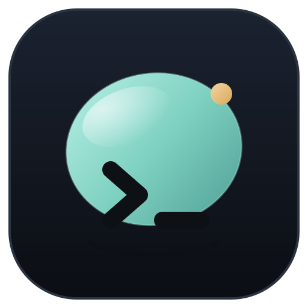

# Pebble



Pebble is a WezTerm fork with a simple mission: **a beautiful terminal
that feels right the moment you launch it on Linux** — no config file
required.

The out-of-the-box experience is tuned around three goals:

1. **It just works** — sensible defaults, generous scrollback (10,000
   lines), your login shell, bundled JetBrains Mono (with Nerd Font
   symbols), and no update-check nagging from the upstream release
   channel.
2. **Linux first** — native Wayland (with background blur on compositors
   that support the background-effect protocol), X11 fallback, IME and
   fish/zsh/bash friendly.
3. **Pebble Quartz** — a graphite blue-grey palette with jade accents and warm
   sand highlights, plus a unified tab/title bar with integrated window
   buttons, a steady bar cursor and subtle translucency.

On Linux, the Pebble tab bar is the window's only title bar; this avoids stacking
the desktop's system title bar over the terminal's own tabs. Resize borders
remain enabled, and the tab bar can be used to drag the window.

Every default can still be overridden in `~/.config/pebble/pebble.lua`. The Lua
API remains compatible with upstream configurations through `require 'wezterm'`.

Pebble is built from the WezTerm codebase; the upstream configuration reference
is available at <https://wezterm.org/>.

## Installation

Build the command-line launcher, GUI, and multiplexer server from source:

```sh
cargo build --release -p wezterm -p wezterm-gui -p wezterm-mux-server
```

The binaries are `pebble`, `pebble-gui`, and `pebble-mux-server`. Run
`pebble --help` to see available commands.

## Getting help

This is a spare time project, so please bear with me.  There are a couple of channels for support:

* Use the [Pebble issue tracker](https://github.com/Praying/pebble/issues) to report bugs or request features.
* For upstream terminal behavior and Lua API details, see the [WezTerm documentation](https://wezterm.org/).

Pebble is a community project derived from WezTerm. Please include your Linux
distribution, desktop session (Wayland or X11), and relevant logs when filing an
issue.

## Upstream

Pebble is built on the work of the WezTerm project. See the upstream project
for development and sponsorship information.
